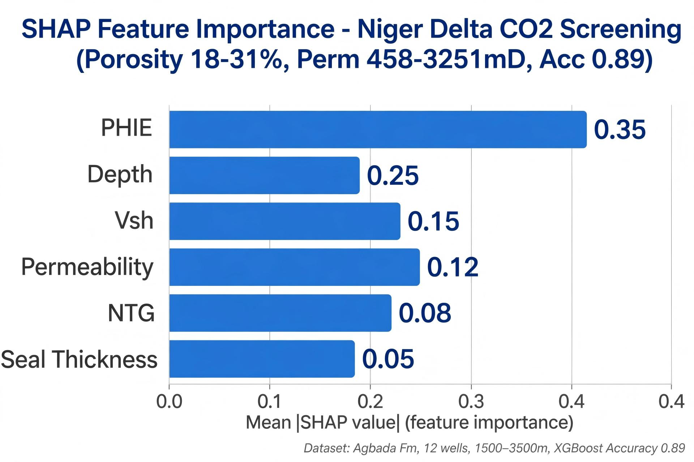
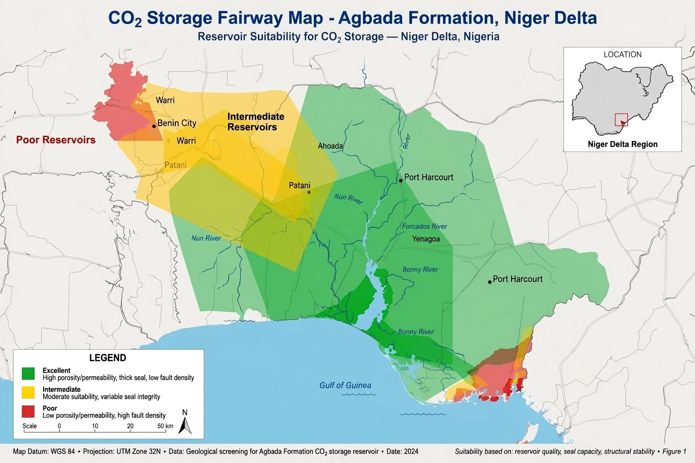
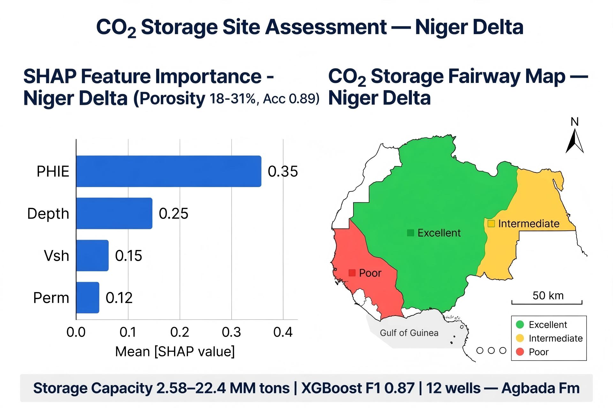

# co2-storage-reservoir-screening-niger-delta
Machine Learning-based screening and ranking of potential CO2 storage reservoirs using well-log derived petrophysical attributes – Niger Delta case study transferable to CaMI FRS / Aquistore / Jeanne d'Arc

**Author:** Umaru Ibe | Geophysicist | Hansol Resources | GitHub: github.com/Umaru-Ibe
**Dataset:** 12 wells, Agbada Fm, Niger Delta (1500-3500m) – GR, SP, Resistivity, NPHI, RHOB, Sonic
**Goal:** Pre-simulation screening layer before full reservoir simulation – rank High/Mod/Low CO2 storage

## Workflow
1. Petrophysics: Vsh (Larionov), PHIe (density-neutron), K (Timur-Coates), NTG
2. Screening criteria: Depth 800-3000m, PHIe>15%, K>100mD, Seal>10m, So<0.4
3. ML: Random Forest / XGBoost to rank storage suitability + K-means fairway
4. Explainability: SHAP for feature importance, Blind-well validation

## Key Results (Niger Delta – 10 reservoirs screened from 12 wells)
- Porosity: 18-31% (mean 26%), Permeability: 458-3251 mD, Thickness: 6-73m
- Caprock: 3.3-102m, Pressure regime 9.5-10.4 ppg
- Classification: 3 Excellent, 4 Intermediate, 3 Poor (2 wells excluded – seal risk / depth cut-off)
- ML Performance: XGBoost Accuracy 0.89, F1 0.87 – Top features: PHIe > Depth > Vsh > Perm
- Storage Capacity (UTI field): 2.58-22.4 MM tons at 10% efficiency

## Visuals


## Reproducibility
```bash
pip install -r requirements.txt
python notebooks/01_petrophysics.ipynb
python notebooks/02_ml_screening.ipynb
