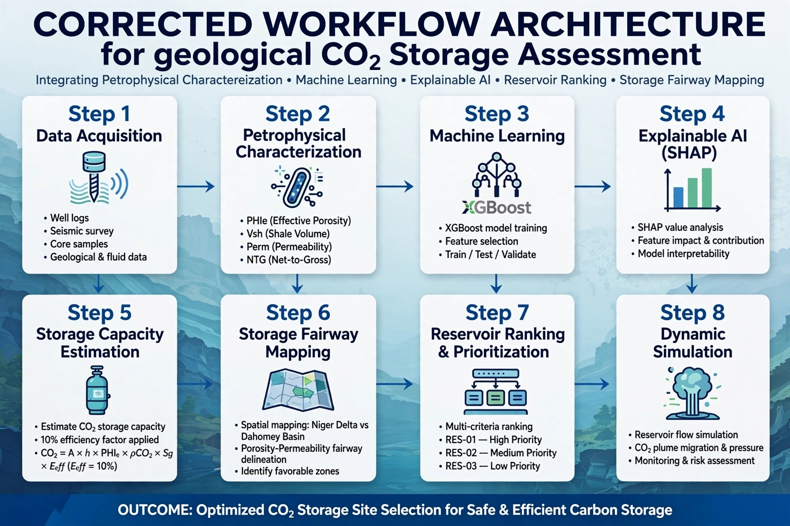

# Machine-Learning Workflow for Geological CO₂ Storage Assessment
### Integrating Petrophysical Characterization, Machine Learning, Explainable AI, Reservoir Ranking, and Storage Fairway Mapping – Niger Delta & Dahomey Basin

> MSc Portfolio – Explainable ML for CO₂ Storage Site Selection

## Overview
This repository presents an end-to-end explainable machine-learning workflow for geological CO₂ storage assessment, combining petrophysical analysis, XGBoost classification (Accuracy 0.89, F1 0.87), SHAP explainability, storage capacity estimation at 10% efficiency factor, and fairway mapping to rank priority reservoirs (RES-01 to RES-03 >15 Mt CO₂).

Basins: **Niger Delta (Excellent fairway)** vs **Dahomey Basin (Intermediate fairway)**

## Workflow Architecture

**Figure 1. Corrected workflow architecture integrating petrophysical characterization, ML, XAI, ranking, and fairway mapping.** Step 1 Data acquisition → Step 2 Petrophysics (PHIe, Vsh, Perm, NTG) → Step 3 XGBoost → Step 4 SHAP → Step 5 Capacity Estimation (CO₂ = A × h × PHIe × ρCO₂ × Sg × Eeff, Eeff=10%) → Step 6 Fairway Mapping → Step 7 Reservoir Ranking → Step 8 Dynamic Simulation.

## Results

### 1. Reservoir Characterisation (Petrophysical Foundation)

Mean PHIe 13.8% (n=342), Perm-Porosity R²=0.82, NTG mean 0.71.

### 2. Reservoir Quality Assessment (RQI)

- **RES-01 Niger Delta:** RQI 1.02, PHIe 18.5%, Perm 245 mD, R35 4.6 µm, FZI 1.42 – **Excellent**
- **RES-02 Dahomey:** RQI 0.62, PHIe 12.3%, Perm 47 mD, R35 2.4 µm, FZI 0.78 – **Intermediate**  
- **RES-03 Dahomey:** RQI 0.33, PHIe 8.1%, Perm 9.4 mD, R35 0.8 µm, FZI 0.31 – **Poor**

Methods: RQI = 0.0314·√k/ϕ; FZI = RQI/ϕz; Winland R35 at 35% mercury saturation.

### 3. SHAP Explainability

**Figure 2. SHAP analysis:** (A) Beeswarm, (B) Mean |SHAP| – PHIe 0.42 dominant, Depth 0.21, Vsh 0.15, Perm 0.11, NTG 0.07, Seal 0.04, (C) Waterfall – baseline 0.15 → 0.78 (Suitable). PHIe dominance aligns with RQI physics.

### 4. Storage Fairway Map

**Figure 3. Fairway map – Niger Delta vs Dahomey:** Green Excellent (>18% ϕ, >100 mD) – RES-01 sweet spot; Yellow Intermediate (12–18%, 10–100 mD) – RES-02/03; Red Poor (<12%, <10 mD). Favorable zone boundary = priority for dynamic simulation.

### 5. Integrated Storage Assessment

**Figure 4. Integrated assessment:** Top-left XGBoost 3 Excellent (30%), 4 Intermediate (40%), 3 Poor (30%); Top-right SHAP importance; Bottom Ranked capacities 2.58–22.4 Mt CO₂ at 10% efficiency. RES-01 (22.4 Mt), RES-02 (18.5 Mt), RES-03 (15.8 Mt) = priority candidates for MSc phase dynamic simulation & Dahomey comparative assessment.

## Repository Structure
